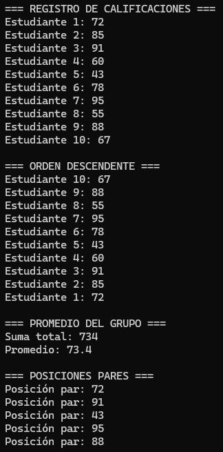
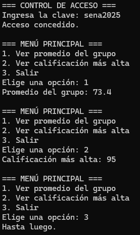
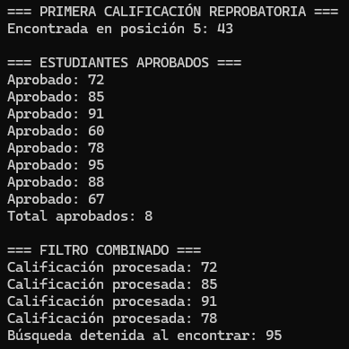

# Reto: Estructuras de Control Iterativo en C#

## Descripción

Este proyecto resuelve el reto de **Estructuras de Control Iterativo en C#**, aplicando los bucles `for`, `foreach`, `while` y `do-while`, además de las sentencias `break` y `continue`, para gestionar y analizar las calificaciones de un grupo de estudiantes.

## Requisitos

- .NET SDK instalado.
- Visual Studio Code u otro editor compatible con C#.
- Una terminal para ejecutar el programa.

## Cómo ejecutar el programa

1. Abre la carpeta del proyecto en Visual Studio Code.
2. Comprueba que el archivo `Program.cs` contiene el código del reto.
3. Abre una terminal en esa carpeta.
4. Ejecuta:

   ```bash
   dotnet run
   ```

El programa presenta las tres secciones de forma secuencial. En la segunda sección, ingresa la clave `sena2025` para probar el acceso y utiliza las opciones del menú para consultar los resultados.

## Sección 1: `for` y `foreach` — Registro y análisis de calificaciones

En esta sección, el programa:

- Muestra las diez calificaciones en orden ascendente e indica el número de estudiante.
- Recorre las calificaciones en orden descendente.
- Calcula la suma total y el promedio mediante `foreach`.
- Recorre los índices pares del array usando un `for` con incremento de dos.

**Resultados de comprobación:** suma total de `734` y promedio de `73.4`.

### Evidencia de funcionamiento

Guarda una captura real de la terminal como `capturas/seccion1-for-foreach.png`. La imagen debe mostrar los resultados del registro, el orden descendente, el promedio y las posiciones pares.



## Sección 2: `while` y `do-while` — Control de acceso y menú

En esta sección, el programa:

- Solicita una clave y permite hasta tres intentos.
- Informa si el acceso fue concedido o bloqueado.
- Muestra un menú que se repite hasta seleccionar la opción `3`.
- Permite consultar el promedio y la calificación más alta, y valida las opciones no reconocidas.

**Resultados de comprobación:** la clave válida es `sena2025`, el promedio es `73.4` y la calificación más alta es `95`.

### Evidencia de funcionamiento

Guarda una captura real de la terminal como `capturas/seccion2-while-do-while.png`. Procura que se vean el acceso concedido, las opciones del menú y al menos una consulta de resultados. También puedes probar una opción inválida para mostrar el mensaje de validación.



## Sección 3: `break` y `continue` — Filtrado y búsqueda

En esta sección, el programa:

- Detiene la búsqueda al encontrar la primera calificación inferior a `60`.
- Omite las calificaciones reprobatorias y cuenta las aprobatorias.
- Combina `continue` para saltar valores menores que `70` y `break` para detener el recorrido al encontrar un valor de `95` o más.

**Resultados de comprobación:** la primera calificación reprobatoria es `43`, ubicada en la posición `5`. Como la condición de aprobación es mayor o igual a `60`, el conteo resultante es `8` estudiantes aprobados. En el filtro combinado, el recorrido se detiene al encontrar `95`.

### Evidencia de funcionamiento

Guarda una captura real de la terminal como `capturas/seccion3-break-continue.png`. La imagen debe mostrar la primera calificación reprobatoria, el listado y total de aprobados, y el resultado del filtro combinado.



## Estructura de archivos

Organiza los archivos de esta forma para que las capturas se muestren en este README:

```text
nombre-del-proyecto/
├── Program.cs
├── README.md
└── capturas/
    ├── seccion1-for-foreach.png
    ├── seccion2-while-do-while.png
    └── seccion3-break-continue.png
```

## Nota sobre los resultados

El enunciado de la actividad presenta dos diferencias entre sus instrucciones y la salida de ejemplo: el criterio escrito considera aprobadas las calificaciones mayores o iguales a `60`, por lo que el total es `8`; y el filtro combinado debe detenerse al encontrar una calificación de `95` o más. Este README documenta esos criterios escritos y los resultados correspondientes al código.
